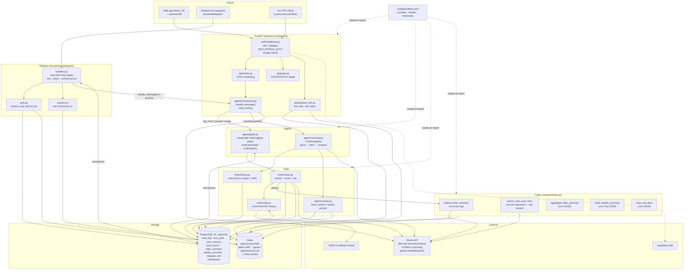
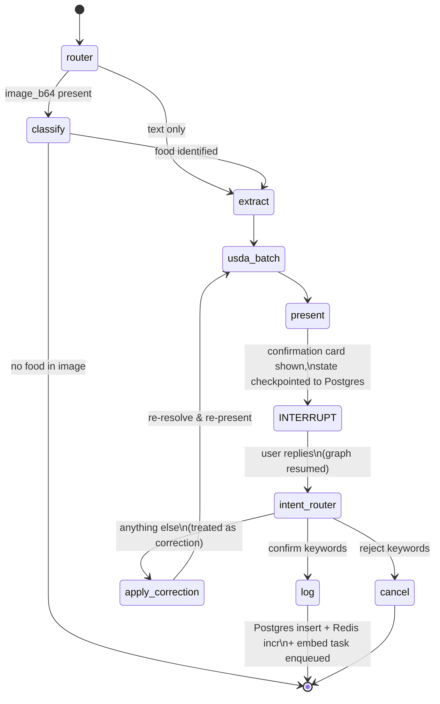
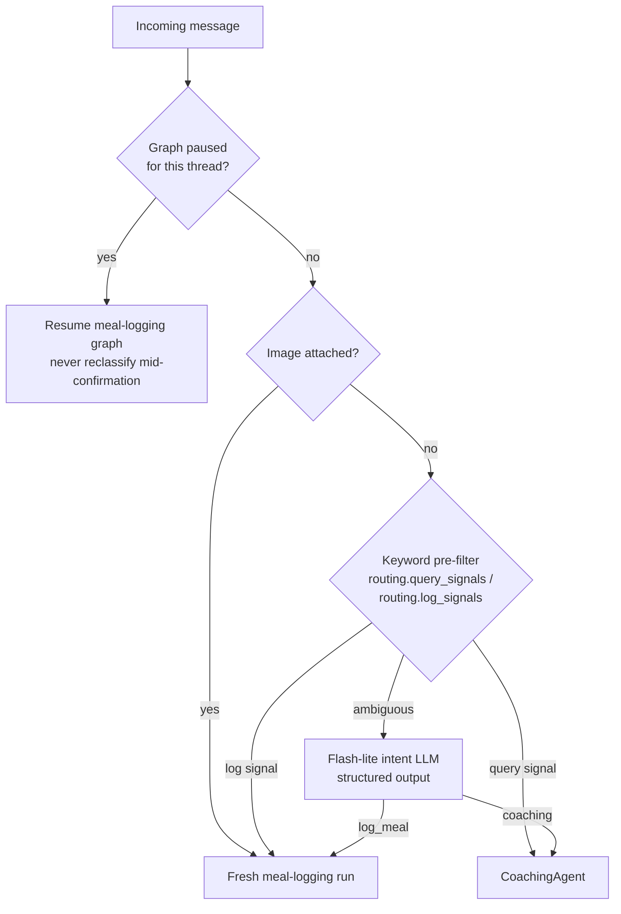

# NutriChat — System Architecture

> Status: reflects the implemented backend as of 2026-06-12 (milestones
> M0–M5 + M7 Telegram bot complete; eval harness not yet built).
> Diagrams are Mermaid — rendered by GitHub, VS Code (with the Mermaid
> extension), or https://mermaid.live.

## 1. System overview

## 2. Meal-logging graph (LangGraph, interrupt-based)

Key property: the conversation can span multiple HTTP requests. The graph
pauses after `present` and its full state is checkpointed (AsyncPostgresSaver,
keyed by `thread_id` = conversation_id). The orchestrator always resumes a
paused graph before re-classifying intent — a "how much protein is that?"
mid-confirmation is treated as a correction/reply, not a new coaching query.

## 3. Message routing decision

## 4. Coaching data-fetch decision table

| Query shape | Source |
|---|---|
| today + macros only | Redis `today:{user}` (Postgres fallback on Redis error) |
| any other date range, macros | Postgres `SUM` over `meal_log` |
| any micronutrient | Postgres JSONB `jsonb_array_elements(entities)` |
| `include_goals` | Postgres `user_goal` |

The response LLM (Gemini 2.5 Flash) only ever sees fetched data — the system
prompt forbids inventing numbers, and graceful "no data" replies short-circuit
before the LLM is called. Two further inputs frame every coaching call:

- **User context** (`agent/context.py` `build_context` → `build_system_prompt`):
  today's totals, goals/streak, the latest weekly pattern, mindful-mode
  safety alerts, and the top-k pgvector preferences for this message. Appended
  to the response agent's instructions; built concurrently with `parse_query`
  and dropped (with a warning) if any of its backends fail.
- **Conversation history** (`db/redis_client.py` `get_coaching_history`): the
  last `memory.coaching_history_turns` exchanges, written by the orchestrator
  after *every* turn — coaching replies verbatim, logging turns as a one-line
  summary of the card or the post-log reply. Replayed as message history for
  the response agent and as a transcript block for `parse_query`, so
  "and yesterday?" can inherit the nutrient from the previous question.

**Guideline retrieval and the feedback loop.** When `parse_query` sets
`needs_guidance`, `guidelines/retrieval.py` embeds the message and runs a
condition-filtered pgvector cosine search over `guideline_chunk` (the user's
`user_goal.conditions` map to chunk tags, always including `general`). It
fetches `retrieval.guideline_top_k` rows and drops anything scoring below
`retrieval.guideline_min_score`, so an uncovered question retrieves nothing
rather than the nearest irrelevant passage. Survivors are rendered as a
delimited, numbered reference block the model cites as `[n]`; the numbers are
mapped back to chunk ids by `extract_citations`. Retrieval is enrichment only —
any failure logs a warning and the coach answers without citations. Every
coaching turn is then persisted by `agent/coaching_store.py` as a
`coaching_response` row (query, parsed query, a snapshot of the passages shown,
citations, reply, model, trace id). The web UI rates it thumbs up/down with an
optional comment via `POST /coaching/{id}/feedback`, and
`guidelines/export_feedback.py` exports the rows as JSONL — the seed for a
coaching eval set.

## 5. Memory layers (PRD §5.1)

| Layer | Storage | Writer | Reader | Status |
|---|---|---|---|---|
| Session (today totals) | Redis, TTL 24h | `log_meal` | coaching, dashboard | ✅ |
| Conversation (last N turns, both intents) | Redis `coach_history:{user}`, TTL 12h | `orchestrator._record_turn` | `CoachingAgent` (parse + respond) | ✅ |
| Episodic (meals) | `meal_log` + embedding | `log_meal` + `embed_meal_summary` | `get_history` | ✅ |
| Semantic (preferences) | `user_memory` + pgvector | `extract_and_store_facts` | `build_context` ANN | ⚠️ task exists, not yet enqueued |
| Procedural (templates) | `meal_template` | — | — | deferred (post-MVP) |
| Long-term patterns | `daily_summary` / `weekly_summary` | nightly/weekly crons | `build_context` | ✅ |

## 6. Configuration

All prompts, model names, token limits, and behavioural thresholds live in
**`src/backend/config/tunables.yaml`**, documented inline per key. Loaded once
per process through `backend.config.get_tunables()` (Pydantic-validated:
unknown keys or wrong types fail at startup, not mid-request). Restart
uvicorn + celery after editing. `NUTRICHAT_TUNABLES_PATH` env var points to an
alternative file for prompt experiments.

Secrets and infrastructure endpoints stay in `.env` (see CLAUDE.md) — the
YAML holds behaviour, not credentials. `LOGFIRE_TOKEN` and
`LOGFIRE_ENVIRONMENT` configure observability (§7); the app and workers run
fine without a token.

## 7. Observability

> Full deep dive (trace trees per action, cost tracking, scrubbing, runbook):
> [`observability.md`](./observability.md).

`src/backend/observability.py` configures **Logfire** (OpenTelemetry) once per
process via `configure_observability()`, called from `main.py` (API process,
with the FastAPI app) and from a Celery `worker_process_init` signal handler
in `workers/tasks.py` (worker processes). Without `LOGFIRE_TOKEN` set,
`send_to_logfire="if-token-present"` makes this a local no-op — safe for tests
and CI.

What is traced:

- FastAPI request/response spans (`logfire.instrument_fastapi`).
- Orchestrator spans: `handle_message` (with `user_id`, `thread_id`,
  `has_image`, and resulting `intent`/`paused` attributes),
  `classify_intent_llm`, `coaching`, and `meal_logging`.
- LangGraph node execution + Gemini calls, via the OpenLLMetry
  `LangchainInstrumentor`.
- The Pydantic AI coaching pilot (`logfire.instrument_pydantic_ai`), plus its
  raw Gemini HTTP calls (`logfire.instrument_httpx`, since GoogleModel uses httpx).
- USDA lookups (`aiohttp` client, via `logfire.instrument_aiohttp_client`),
  Postgres (`asyncpg`), Redis, and Celery task execution.
- **LLM cost** (`src/backend/agent/cost.py`): each Pydantic AI run is priced with
  `genai-prices` and emitted as an `llm_cost` log-point plus a `gen_ai.cost_usd`
  metric counter, labelled by model and operation.

**Image scrubbing:** a custom `ScrubbingOptions` callback
(`_scrub_extra`) redacts any span attribute whose key contains `image_b64`,
any `data:image/...;base64,` URI, and any string value that looks like a
base64 blob over 1KB — replacing the value with `"<redacted image>"` before
export. `image_b64` content (and the LangGraph `checkpointer`) is never
passed as a span attribute directly.

## 8. Idempotency & failure properties

| Operation | Property |
|---|---|
| `aggregate_daily_summary` / `build_weekly_summary` | Idempotent — `ON CONFLICT … DO UPDATE` upserts; safe to re-run for any date |
| `embed_meal_summary` | Idempotent — overwrites `meal_log.embedding`; no-op if meal deleted |
| `extract_and_store_facts` | Convergent — cosine-distance dedup (< 0.05) suppresses near-duplicates |
| `reset_day_keys` | Idempotent — Redis DELETE |
| USDA cache write | Idempotent — `ON CONFLICT (fdc_id) DO NOTHING` |
| `log_meal` | **Not idempotent** — but protected by graph structure: the `log` node runs at most once per confirmation interrupt; a second "yes" on the same thread finds the graph at END and starts a fresh extraction instead |
| Postgres insert + Redis increment | Not atomic — if Redis fails after the insert, today's totals undercount until the nightly aggregate; Postgres is the source of truth |
| Celery task DB engine | Each task runs in a fresh event loop and disposes the engine afterwards (`_run()` wrapper) — prevents cross-loop asyncpg failures |

## 9. Integration API

`/v1/integrations/*` (see [docs/integration-api.md](integration-api.md))
exposes a read-only, service-token-authenticated feed of meals, daily/weekly
summaries, and goals for third-party consumers. Auth is separate from
Supabase user JWTs — tokens are minted offline via
`backend.scripts.mint_token` and validated by
`backend.auth.integration.get_integration_user`. `meal_log` carries
`updated_at`/`deleted_at` (with `moddatetime` triggers) so consumers can poll
with keyset cursors and reconcile soft-deletes as tombstones.
