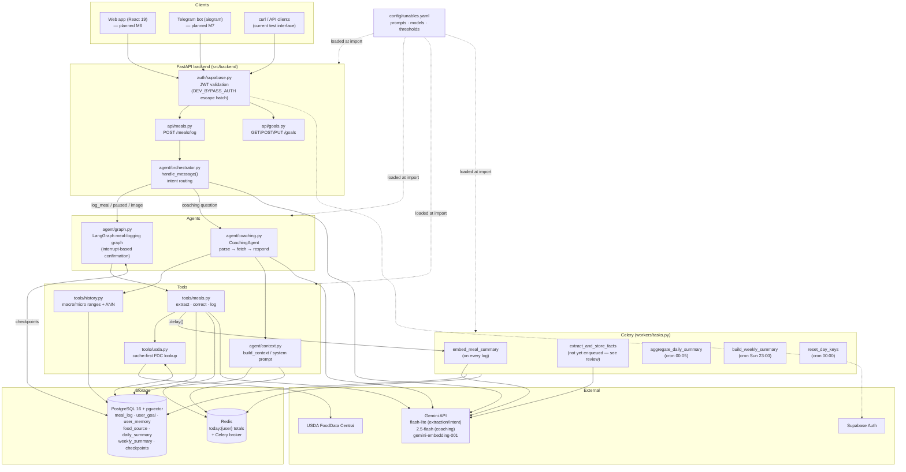
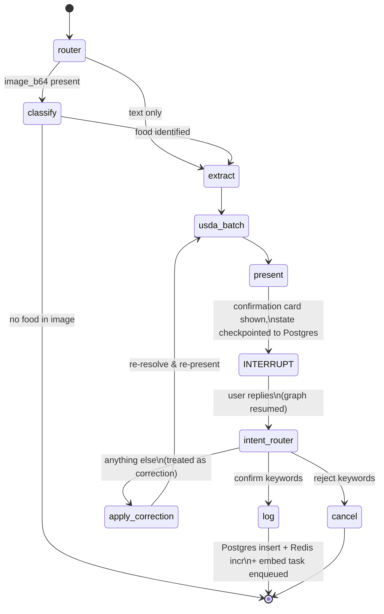
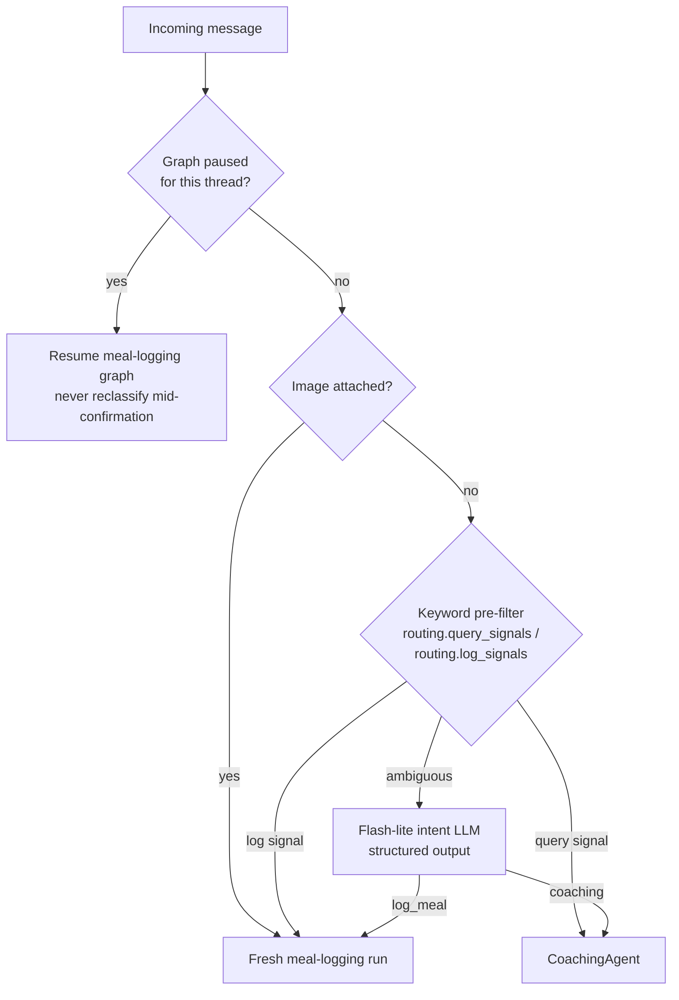

# NutriChat — System Architecture

> Status: reflects the implemented backend as of 2026-06-11 (milestones M0–M5
> complete; web frontend, Telegram bot, and eval harness not yet built).
> Diagrams are Mermaid — rendered by GitHub, VS Code (with the Mermaid
> extension), or https://mermaid.live.

## 1. System overview

## 2. Meal-logging graph (LangGraph, interrupt-based)

Key property: the conversation can span multiple HTTP requests. The graph
pauses after `present` and its full state is checkpointed (AsyncPostgresSaver,
keyed by `thread_id` = conversation_id). The orchestrator always resumes a
paused graph before re-classifying intent — a "how much protein is that?"
mid-confirmation is treated as a correction/reply, not a new coaching query.

## 3. Message routing decision

## 4. Coaching data-fetch decision table

| Query shape | Source |
|---|---|
| today + macros only | Redis `today:{user}` (Postgres fallback on Redis error) |
| any other date range, macros | Postgres `SUM` over `meal_log` |
| any micronutrient | Postgres JSONB `jsonb_array_elements(entities)` |
| `include_goals` | Postgres `user_goal` |

The response LLM (Gemini 2.5 Flash) only ever sees fetched data — the system
prompt forbids inventing numbers, and graceful "no data" replies short-circuit
before the LLM is called.

## 5. Memory layers (PRD §5.1)

| Layer | Storage | Writer | Reader | Status |
|---|---|---|---|---|
| Session (today totals) | Redis, TTL 24h | `log_meal` | coaching, dashboard | ✅ |
| Episodic (meals) | `meal_log` + embedding | `log_meal` + `embed_meal_summary` | `get_history` | ✅ |
| Semantic (preferences) | `user_memory` + pgvector | `extract_and_store_facts` | `build_context` ANN | ⚠️ task exists, not yet enqueued |
| Procedural (templates) | `meal_template` | — | — | deferred (post-MVP) |
| Long-term patterns | `daily_summary` / `weekly_summary` | nightly/weekly crons | `build_context` | ✅ |

## 6. Configuration

All prompts, model names, token limits, and behavioural thresholds live in
**`src/backend/config/tunables.yaml`**, documented inline per key. Loaded once
per process through `backend.config.get_tunables()` (Pydantic-validated:
unknown keys or wrong types fail at startup, not mid-request). Restart
uvicorn + celery after editing. `NUTRICHAT_TUNABLES_PATH` env var points to an
alternative file for prompt experiments.

Secrets and infrastructure endpoints stay in `.env` (see CLAUDE.md) — the
YAML holds behaviour, not credentials.

## 7. Idempotency & failure properties

| Operation | Property |
|---|---|
| `aggregate_daily_summary` / `build_weekly_summary` | Idempotent — `ON CONFLICT … DO UPDATE` upserts; safe to re-run for any date |
| `embed_meal_summary` | Idempotent — overwrites `meal_log.embedding`; no-op if meal deleted |
| `extract_and_store_facts` | Convergent — cosine-distance dedup (< 0.05) suppresses near-duplicates |
| `reset_day_keys` | Idempotent — Redis DELETE |
| USDA cache write | Idempotent — `ON CONFLICT (fdc_id) DO NOTHING` |
| `log_meal` | **Not idempotent** — but protected by graph structure: the `log` node runs at most once per confirmation interrupt; a second "yes" on the same thread finds the graph at END and starts a fresh extraction instead |
| Postgres insert + Redis increment | Not atomic — if Redis fails after the insert, today's totals undercount until the nightly aggregate; Postgres is the source of truth |
| Celery task DB engine | Each task runs in a fresh event loop and disposes the engine afterwards (`_run()` wrapper) — prevents cross-loop asyncpg failures |
