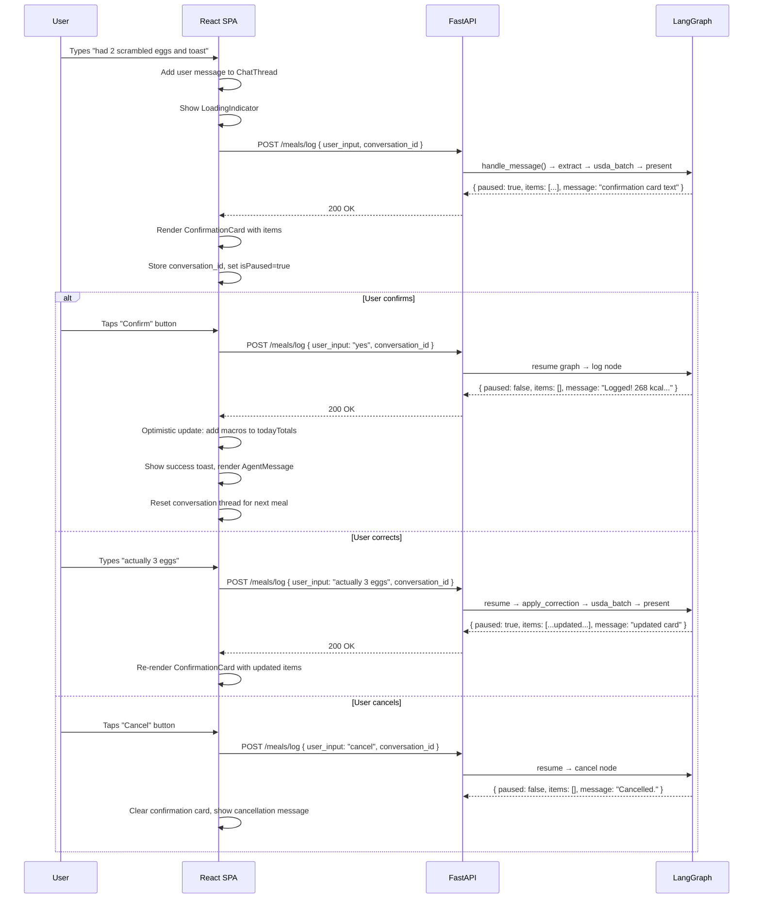

# NutriChat — Front-End Design Document

**Version:** 1.0 — June 2026  
**Status:** Draft  
**Derived from:** [PRD v2.0](context/nutrichat-prd-final.md) · [Architecture](architecture.md) · [Meal Logging Spec](archive/superpowers/specs/2026-04-05-meal-logging-agent-design.md) · [Coaching Spec](archive/superpowers/specs/2026-04-05-coaching-agent-foundation-design.md)  
**Backend status:** M0–M5 complete; API layer, agent pipeline, coaching agent all operational  

---

## Table of Contents

1. [Overview & Goals](#1-overview--goals)
2. [Technology Stack](#2-technology-stack)
3. [Architecture Overview](#3-architecture-overview)
4. [Authentication Flow](#4-authentication-flow)
5. [API Contract (Backend Surface)](#5-api-contract-backend-surface)
6. [Pages & Routes](#6-pages--routes)
7. [Component Hierarchy](#7-component-hierarchy)
8. [State Management](#8-state-management)
9. [Data Models (TypeScript)](#9-data-models-typescript)
10. [Core Interaction Flows](#10-core-interaction-flows)
11. [Design System & Visual Language](#11-design-system--visual-language)
12. [Charts & Data Visualisation](#12-charts--data-visualisation)
13. [PWA & Offline Support](#13-pwa--offline-support)
14. [Performance Budgets](#14-performance-budgets)
15. [Accessibility](#15-accessibility)
16. [Error Handling & Edge Cases](#16-error-handling--edge-cases)
17. [Feature Phasing](#17-feature-phasing)
18. [File Structure](#18-file-structure)
19. [Open Questions](#19-open-questions)

---

## 1. Overview & Goals

### Product context

NutriChat is a conversational nutrition tracker grounded in USDA FoodData Central. Users type (or photograph) what they ate; an agentic backend extracts entities, resolves them to USDA foods, presents a confirmation card, and logs the meal — all in under 3 seconds P95.

### Front-end mission

Build a **React 19 + TypeScript** single-page app that:

1. Provides a **chat-first interface** for meal logging and coaching queries
2. Renders **structured confirmation cards** with editable food items before logging
3. Displays a **real-time dashboard** of today's macro progress (kcal, protein, fiber)
4. Supports **image upload** (food photo → classification → entity extraction)
5. Works as an **installable PWA** with offline queuing
6. Gates premium features behind a **Stripe-powered paywall** (Phase 2)

### Success criteria (from PRD §11)

| Metric | Target |
|---|---|
| Meal log E2E P95 latency | < 3,000 ms |
| Dashboard update after log | < 500 ms (optimistic) |
| Onboarding completion rate | ≥ 70% (n=10 internal beta) |
| Day-14 retention | ≥ 40% |
| Pro conversion | ≥ 5% of free users within 30 days |

---

## 2. Technology Stack

> PRD §4.2 — confirmed, no deviations.

| Layer | Technology | Version | Purpose |
|---|---|---|---|
| Framework | React | 19 | Hooks, transitions, use() |
| Language | TypeScript | 5.x | Type-safe components, API types |
| Build | Vite | 6.x | Sub-second HMR, tree-shaking |
| Styling | Tailwind CSS | v4 | Utility-first, zero runtime CSS, `@theme` |
| Components | shadcn/ui | latest | Accessible, unstyled primitives (Dialog, Sheet, Toast, etc.) |
| State | Zustand | 5.x | 1 KB, no boilerplate, selector-based |
| Data fetching | TanStack Query | v5 | Cache, mutations, optimistic updates, streaming |
| Charts | Recharts | 2.x | Macro rings (RadialBarChart), weekly bars (BarChart), trend lines |
| Routing | React Router | v7 | File-based optional, SPA mode |
| PWA | vite-plugin-pwa | latest | Service worker, offline queue, install prompt |
| Auth | Supabase JS | v2 | `@supabase/supabase-js` — JWT issuance, social login |
| Payments | Stripe.js | latest | Checkout redirect for Pro tier (Phase 2) |
| Hosting | Vercel | — | Git-deploy, edge functions for middleware |

### Why these choices (non-obvious)

- **Zustand over Redux/Jotai**: PRD specifies "lightweight, no boilerplate". The store shape is simple (today totals + conversation state + UI flags).
- **TanStack Query over SWR**: The mutation + optimistic update story is stronger — critical for the "log → instant dashboard update" pattern.
- **shadcn/ui over Radix directly**: Copy-paste model means zero vendor lock-in; components live in the repo and are fully customizable.
- **Recharts over Chart.js/Nivo**: Declarative React API, works with responsive containers, supports the radial bar (calorie ring) and stacked bar (weekly chart) patterns the PRD calls for.

---

## 3. Architecture Overview

```
┌──────────────────────────────────────────────────────┐
│  React SPA (Vercel)                                  │
│                                                      │
│  ┌──────────┐   ┌────────────┐   ┌───────────────┐  │
│  │  Pages   │ → │ Components │ → │ Zustand Store │  │
│  │(Router)  │   │            │   │               │  │
│  └──────────┘   └────────────┘   └───────┬───────┘  │
│                                          │          │
│  ┌───────────────────────────────────────┘          │
│  │  TanStack Query (api/client.ts)                  │
│  │  ┌─────────────────────────────────────────────┐ │
│  │  │ useLogMeal · useDashboard · useGoals        │ │
│  │  │ useCoaching · useWeeklySummary              │ │
│  │  └─────────────────────────────────────────────┘ │
│  └──────────────────────────────────────────────────┘
│                        │  HTTP (JWT in Authorization)
│                        ▼
│  ┌──────────────────────────────────────────────────┐
│  │  FastAPI backend (Railway)                       │
│  │  POST /meals/log · GET /dashboard/today          │
│  │  GET/POST/PUT /goals · POST /billing/checkout    │
│  └──────────────────────────────────────────────────┘
```

### Key architectural constraints

1. **The backend API returns a unified response shape** — `{ status, message, paused, items }` — for both meal logging and coaching. The frontend must handle both branches from the same endpoint.
2. **Conversation threading** — the `conversation_id` field tracks multi-turn meal corrections (confirm / correct / cancel). The graph is checkpointed server-side; the frontend just passes `conversation_id` on subsequent messages in the same thread.
3. **No WebSocket / SSE** — Phase 1 uses request-response. Streaming (first-token latency) is an open question for Phase 2.
4. **Auth is Supabase-managed** — the frontend sends `Authorization: Bearer <supabase_access_token>` on every API call; the backend validates via HS256 JWT.

---

## 4. Authentication Flow

> Backend implementation: [supabase.py](file:///home/aswinmanohar/nutrichat/src/backend/auth/supabase.py)

### Sign-up / Sign-in

```
User → Supabase Auth UI (hosted or embedded)
     → Supabase issues access_token + refresh_token
     → Frontend stores tokens via @supabase/supabase-js (localStorage)
     → All API calls: Authorization: Bearer <access_token>
```

### Supabase client setup

```typescript
// lib/supabase.ts
import { createClient } from '@supabase/supabase-js'

export const supabase = createClient(
  import.meta.env.VITE_SUPABASE_URL,
  import.meta.env.VITE_SUPABASE_ANON_KEY
)
```

### Auth state management

- **Zustand `authStore`** holds `user`, `session`, `isLoading`
- On app mount: `supabase.auth.getSession()` → populate store
- On `onAuthStateChange('SIGNED_IN' | 'SIGNED_OUT')` → update store
- Protected routes redirect to `/login` when `!session`
- Token refresh is handled automatically by `@supabase/supabase-js`

### No dev bypass

The former `DEV_BYPASS_AUTH` / `X-Debug-User-Id` escape hatch was removed in the production cutover. Local development signs in with a real Supabase account; backend tests override the `get_current_user_id` dependency instead.

---

## 5. API Contract (Backend Surface)

> Derived from the implemented backend: [meals.py](file:///home/aswinmanohar/nutrichat/src/backend/api/meals.py), [goals.py](file:///home/aswinmanohar/nutrichat/src/backend/api/goals.py), [orchestrator.py](file:///home/aswinmanohar/nutrichat/src/backend/agent/orchestrator.py)

### 5.1 `POST /meals/log` — Core conversational endpoint

Handles **both** meal logging and coaching queries. The backend classifies intent and routes internally.

**Request:**
```typescript
interface LogMealRequest {
  user_input: string          // Natural language — "had 2 eggs and toast" or "how much protein today?"
  conversation_id?: string    // For multi-turn correction threads
  image_b64?: string          // Base64-encoded food photo
}
```

**Response:**
```typescript
interface LogMealResponse {
  status: 'success' | 'error'
  message: string             // Agent's text reply (confirmation card, coaching answer, or logged confirmation)
  paused: boolean             // true = confirmation card shown, awaiting user confirm/correct/cancel
  items: ConfirmationItem[]   // Structured food items — only populated when paused=true
}

interface ConfirmationItem {
  food_name: string           // USDA food name
  qty_g: number               // Weight in grams
  confidence: number          // Match confidence 0–1
  kcal: number                // Scaled to qty_g
  protein_g: number
  carbs_g: number
  fat_g: number
  fiber_g: number
  fdc_id: number              // USDA FoodData Central ID
  candidates: string[]        // Top-3 alternative FDC descriptions
}
```

**Conversation lifecycle:**

```
1. User sends meal text →  paused=true,  items=[...entities...]
2. User sends "yes"     →  paused=false, items=[], message="Logged! 268 kcal..."
   OR
2. User sends "actually 3 eggs" → paused=true, items=[...updated entities...]
3. User sends "yes"     →  paused=false, items=[], message="Logged! 332 kcal..."
   OR
2. User sends "cancel"  →  paused=false, items=[], message="Cancelled."
```

### 5.2 `GET /goals` — Retrieve user goals

**Response:**
```typescript
interface GoalResponse {
  kcal_goal: number
  protein_goal: number
  fiber_goal: number
  dietary_prefs: Record<string, unknown>
  streak_days: number
}
```

Returns `404` if user has not been onboarded.

### 5.3 `POST /goals` — Create goals (onboarding)

**Request:**
```typescript
interface GoalCreate {
  kcal_goal: number    // > 0
  protein_goal: number // > 0
  fiber_goal: number   // > 0
  dietary_prefs?: Record<string, unknown>
}
```

Returns `409` if user already has goals. Response: `GoalResponse`.

### 5.4 `PUT /goals` — Update goals

Same shape as `GoalCreate`. Returns `404` if user not onboarded. Response: `GoalResponse`.

### 5.5 `GET /dashboard/today` — Today's totals (planned)

> Not yet implemented in backend. Will read from Redis session totals.

**Expected response:**
```typescript
interface DashboardTodayResponse {
  kcal: number
  protein_g: number
  fiber_g: number
  n_meals: number
}
```

> **Until this endpoint is built**, the frontend can derive today's totals by maintaining an optimistic cache updated on each `POST /meals/log` that returns `paused=false`.

### 5.6 `GET /health` — Health check

Returns `{ status: "ok" }`.

### 5.7 Future endpoints (Phase 2)

| Endpoint | Purpose |
|---|---|
| `POST /billing/checkout` | Stripe checkout session creation |
| `POST /billing/webhook` | Stripe webhook handler |
| `GET /dashboard/weekly` | Pre-aggregated weekly summary |
| `GET /meals/history` | Paginated meal log with search |

---

## 6. Pages & Routes

```
/                     → Redirect to /chat (authed) or /login (unauthed)
/login                → Auth page (Supabase sign-in/sign-up)
/onboarding           → Goal setup wizard (shown once after first sign-up)
/chat                 → Main chat interface + dashboard sidebar
/history              → Meal history with search/filter (Phase 2)
/settings             → Goal editing, dietary preferences, account
/upgrade              → Pro tier paywall (Phase 2)
```

### Route guards

| Route | Guard |
|---|---|
| `/login` | Redirect to `/chat` if already authenticated |
| `/onboarding` | Redirect to `/chat` if goals already exist (`GET /goals` returns 200) |
| `/chat`, `/history`, `/settings` | Redirect to `/login` if unauthenticated |
| `/chat` | Redirect to `/onboarding` if goals not set (404 from `GET /goals`) |

---

## 7. Component Hierarchy

### 7.1 Page-level layout

```
<App>
├── <AuthProvider>                    # Supabase auth context
│   ├── <RouterProvider>
│   │   ├── <LoginPage />
│   │   ├── <OnboardingPage />
│   │   ├── <ProtectedLayout>        # Auth guard + sidebar
│   │   │   ├── <Sidebar />          # Navigation + mini-dashboard
│   │   │   ├── <ChatPage />         # Main view
│   │   │   ├── <HistoryPage />      # Phase 2
│   │   │   └── <SettingsPage />
│   │   └── <UpgradePage />          # Phase 2
```

### 7.2 Chat page (primary view)

```
<ChatPage>
├── <DashboardPanel>                  # Collapsible right panel (desktop) / top sheet (mobile)
│   ├── <MacroRings />               # kcal / protein / fiber radial progress
│   ├── <MealTimeline />             # Today's logged meals in chronological order
│   └── <WeeklyChart />              # 7-day bar chart (Phase 2)
│
├── <ChatThread>                      # Scrollable message list
│   ├── <UserMessage />              # User's typed input
│   ├── <AgentMessage />             # Agent's text reply
│   ├── <ConfirmationCard />         # Structured meal review (when paused=true)
│   │   ├── <FoodItemRow />          # Per-item: name, qty, macros, confidence badge
│   │   │   ├── <QuantityEditor />   # Inline qty_g editing
│   │   │   ├── <ConfidenceBadge />  # ✅ high / ⚠ low / ❌ miss
│   │   │   └── <CandidateSelect /> # Alternative USDA matches dropdown
│   │   ├── <MacroSummary />         # Totals row (kcal, protein, carbs, fat, fiber)
│   │   └── <CardActions />          # Confirm / Edit / Cancel buttons
│   └── <CoachingResponse />         # Coaching answer (when paused=false, items=[])
│
├── <ChatInput>                       # Input bar
│   ├── <TextInput />                # Auto-growing textarea
│   ├── <ImageUploadButton />        # Camera / gallery picker
│   └── <SendButton />              # Submit
│
└── <LoadingIndicator />             # Skeleton / typing dots during API call
```

### 7.3 Onboarding page

```
<OnboardingPage>
├── <OnboardingProgress />            # Step indicator (3 steps)
├── <Step1_TDEE />                    # Weight, height, age, activity → TDEE calculation
│   ├── <UnitToggle />               # kg/lbs, cm/ft
│   └── <ActivitySelector />         # Sedentary → Very Active
├── <Step2_Goals />                    # Auto-filled kcal, editable protein + fiber
│   ├── <GoalSlider />               # kcal_goal
│   ├── <GoalSlider />               # protein_goal
│   └── <GoalSlider />               # fiber_goal
└── <Step3_Preferences />             # Dietary restrictions, allergies, disliked foods
    ├── <PreferenceChips />           # Vegan, Vegetarian, Gluten-free, etc.
    └── <FreeTextInput />            # Custom restrictions
```

Target: **completion in < 90 seconds** (PRD F4).

### 7.4 Settings page

```
<SettingsPage>
├── <GoalEditor />                    # PUT /goals — same sliders as onboarding
├── <DietaryPreferences />            # Edit dietary_prefs JSONB
├── <AccountSection />                # Email, sign out, delete account
└── <ProBadge />                      # Phase 2 — subscription status
```

---

## 8. State Management

### 8.1 Zustand stores

Three focused stores, following single-responsibility:

#### `authStore`

```typescript
interface AuthState {
  user: User | null
  session: Session | null
  isLoading: boolean
  signIn: (email: string, password: string) => Promise<void>
  signUp: (email: string, password: string) => Promise<void>
  signOut: () => Promise<void>
}
```

#### `mealStore`

```typescript
interface MealState {
  // Active conversation thread
  conversationId: string | null
  messages: ChatMessage[]
  isPaused: boolean                    // Confirmation card is showing
  pendingItems: ConfirmationItem[]     // Items in the active confirmation card
  isLoading: boolean

  // Today's dashboard (optimistic)
  todayTotals: TodayTotals

  // Actions
  sendMessage: (input: string, imageB64?: string) => Promise<void>
  confirmMeal: () => Promise<void>
  cancelMeal: () => Promise<void>
  correctMeal: (correction: string) => Promise<void>
  resetConversation: () => void
}
```

#### `goalStore`

```typescript
interface GoalState {
  goals: GoalResponse | null
  isOnboarded: boolean
  fetchGoals: () => Promise<void>
  createGoals: (data: GoalCreate) => Promise<void>
  updateGoals: (data: GoalUpdate) => Promise<void>
}
```

### 8.2 TanStack Query keys

```typescript
const queryKeys = {
  goals: ['goals'] as const,
  dashboard: {
    today: ['dashboard', 'today'] as const,
    weekly: (weekStart: string) => ['dashboard', 'weekly', weekStart] as const,
  },
  meals: {
    history: (filters: MealFilters) => ['meals', 'history', filters] as const,
  },
} as const
```

### 8.3 Optimistic updates strategy

When the user confirms a meal (`paused=true` → user sends "yes" → `paused=false`):

1. **Immediately** update `todayTotals` in `mealStore` by summing `pendingItems` macros
2. **Immediately** add the confirmed meal to the local meal timeline
3. **Invalidate** `queryKeys.dashboard.today` to refetch authoritative totals from backend
4. If the refetch returns different values (e.g., rounding), silently reconcile

This ensures the dashboard updates within < 500ms of logging (PRD F3).

---

## 9. Data Models (TypeScript)

```typescript
// ─── API request/response types ─────────────────────────────

interface LogMealRequest {
  user_input: string
  conversation_id?: string
  image_b64?: string
}

interface LogMealResponse {
  status: 'success' | 'error'
  message: string
  paused: boolean
  items: ConfirmationItem[]
}

interface ConfirmationItem {
  food_name: string
  qty_g: number
  confidence: number
  kcal: number
  protein_g: number
  carbs_g: number
  fat_g: number
  fiber_g: number
  fdc_id: number
  candidates: string[]
}

interface GoalResponse {
  kcal_goal: number
  protein_goal: number
  fiber_goal: number
  dietary_prefs: Record<string, unknown>
  streak_days: number
}

interface GoalCreate {
  kcal_goal: number
  protein_goal: number
  fiber_goal: number
  dietary_prefs?: Record<string, unknown>
}

type GoalUpdate = GoalCreate

interface TodayTotals {
  kcal: number
  protein_g: number
  fiber_g: number
  n_meals: number
}

// ─── Internal UI types ──────────────────────────────────────

type MessageRole = 'user' | 'agent'

interface ChatMessage {
  id: string                          // Client-generated UUID
  role: MessageRole
  content: string                     // Text content
  timestamp: Date
  type: 'text' | 'confirmation' | 'coaching' | 'system'
  items?: ConfirmationItem[]          // Only for type='confirmation'
  paused?: boolean                    // Whether this message awaits user action
}

type MealType = 'breakfast' | 'lunch' | 'dinner' | 'snack' | 'unspecified'

interface MealEntry {
  meal_id: string
  meal_type: MealType
  logged_at: Date
  kcal: number
  protein_g: number
  carbs_g: number
  fat_g: number
  fiber_g: number
  items: ConfirmationItem[]
}
```

---

## 10. Core Interaction Flows

### 10.1 Text meal logging



### 10.2 Image meal logging

```
1. User taps camera button → native file picker / camera
2. Frontend reads image as base64 string
3. POST /meals/log { user_input: "logged this", image_b64: "..." }
4. Backend: router → classify → extract → usda_batch → present
5. Response: { paused: true, items: [...], message: "card" }
6. Same confirm/correct/cancel flow as text
```

> Image resizing: client-side to max 1024px before encoding to reduce payload. Use `<canvas>` for resizing.

### 10.3 Coaching query

```
1. User types "how much protein did I have today?"
2. POST /meals/log { user_input: "how much protein today?" }
3. Backend classifies → coaching → parse → fetch → respond
4. Response: { paused: false, items: [], message: "You've had 87g protein..." }
5. Frontend renders as CoachingResponse (no confirmation card)
```

### 10.4 Onboarding

```
1. User signs up → redirect to /onboarding
2. Step 1: Enter weight, height, age, activity level → TDEE calculated client-side
3. Step 2: Review auto-calculated kcal_goal, adjust protein_goal and fiber_goal
4. Step 3: Select dietary preferences (chips + free text)
5. Submit → POST /goals { kcal_goal, protein_goal, fiber_goal, dietary_prefs }
6. On 201 → redirect to /chat
```

TDEE calculation (Mifflin-St Jeor, client-side):

```typescript
function calculateTDEE(
  weight_kg: number,
  height_cm: number,
  age: number,
  sex: 'male' | 'female',
  activity: number
): number {
  const bmr = sex === 'male'
    ? 10 * weight_kg + 6.25 * height_cm - 5 * age + 5
    : 10 * weight_kg + 6.25 * height_cm - 5 * age - 161
  return Math.round(bmr * activity)
}
```

---

## 11. Design System & Visual Language

### 11.1 Design principles

1. **Chat-first**: The chat thread is the primary interaction surface. Dashboard is secondary/contextual.
2. **Confirmation before commitment**: Meals are always previewed in a structured card before logging — never auto-logged.
3. **Glanceable progress**: Macro rings visible at all times (sidebar on desktop, top bar on mobile).
4. **Trust through data**: Every number shown is USDA-sourced. Confidence badges build trust.
5. **Minimal chrome**: The app should feel like a messaging app, not a spreadsheet.

### 11.2 Color palette

```css
/* Light mode */
--bg-primary:       hsl(210, 20%, 98%);
--bg-secondary:     hsl(210, 15%, 95%);
--bg-chat:          hsl(0, 0%, 100%);
--text-primary:     hsl(220, 15%, 15%);
--text-secondary:   hsl(220, 10%, 45%);

/* Macro colors — consistent across rings, cards, charts */
--color-kcal:       hsl(25, 95%, 55%);      /* Warm orange */
--color-protein:    hsl(210, 80%, 55%);     /* Blue */
--color-fiber:      hsl(145, 65%, 42%);     /* Green */
--color-carbs:      hsl(45, 90%, 50%);      /* Gold */
--color-fat:        hsl(340, 70%, 55%);     /* Rose */

/* Confidence */
--color-high-conf:  hsl(145, 65%, 42%);     /* Green — ≥ 0.85 */
--color-low-conf:   hsl(40, 95%, 50%);      /* Amber — 0.6–0.85 */
--color-miss:       hsl(0, 75%, 55%);       /* Red — < 0.6 or fdc_id=-1 */

/* Accent */
--color-accent:     hsl(210, 80%, 55%);
--color-accent-hover: hsl(210, 80%, 48%);

/* Dark mode (togglable) */
--bg-primary-dark:  hsl(220, 20%, 10%);
--bg-secondary-dark: hsl(220, 15%, 14%);
--bg-chat-dark:     hsl(220, 18%, 12%);
--text-primary-dark: hsl(210, 15%, 92%);
```

### 11.3 Typography

```css
--font-sans: 'Inter', system-ui, -apple-system, sans-serif;
--font-mono: 'JetBrains Mono', monospace;   /* Nutrient values */

/* Scale */
--text-xs:   0.75rem;   /* 12px — confidence labels */
--text-sm:   0.875rem;  /* 14px — secondary text */
--text-base: 1rem;      /* 16px — body */
--text-lg:   1.125rem;  /* 18px — card headers */
--text-xl:   1.25rem;   /* 20px — page titles */
--text-2xl:  1.5rem;    /* 24px — dashboard numbers */
--text-4xl:  2.25rem;   /* 36px — hero macro number in ring */
```

### 11.4 Responsive breakpoints

```
mobile:  < 768px   → Single column, chat fullscreen, dashboard in top sheet
tablet:  768–1024px → Chat + collapsible sidebar
desktop: > 1024px  → Chat (60%) + dashboard panel (40%)
```

### 11.5 Key UI patterns

| Pattern | Component | Notes |
|---|---|---|
| Confirmation card | `<ConfirmationCard>` | Card with rounded corners, subtle shadow, grouped food items. Action buttons (Confirm/Cancel) at bottom. |
| Macro ring | `<MacroRings>` | Three concentric radial bars. Center shows the primary number (kcal consumed). |
| Confidence badge | `<ConfidenceBadge>` | ✅ (≥0.85), ⚠️ (0.6–0.85), 🔴 (<0.6). Tooltip shows "USDA match: 72%". |
| Typing indicator | `<TypingDots>` | Three animated dots in agent message bubble during API call. |
| Toast | `<Toast>` (shadcn) | "Logged: 268 kcal, 17g protein" — auto-dismiss after 3s. |
| Empty state | `<EmptyState>` | "Start by logging your first meal! Just type what you ate." |

---

## 12. Charts & Data Visualisation

### 12.1 Macro rings (Dashboard — `<MacroRings>`)

- **Recharts `RadialBarChart`** with three rings: kcal (outer), protein (middle), fiber (inner)
- Each ring shows current / goal as a percentage fill
- Center text: total kcal consumed (large) / goal (small)
- Animate on mount and on value update (spring transition)
- Colors: `--color-kcal`, `--color-protein`, `--color-fiber`

### 12.2 Meal timeline (`<MealTimeline>`)

- Vertical timeline of today's meals, ordered by `logged_at`
- Each entry: meal type icon + food names + total kcal
- Tappable to expand full item breakdown
- Empty state: dashed line with "No meals logged yet"

### 12.3 Weekly bar chart (`<WeeklyChart>` — Phase 2)

- Recharts `BarChart`, 7 days
- Stacked bars: protein (blue) + carbs (gold) + fat (rose)
- Goal line overlay (dashed horizontal)
- X-axis: Mon–Sun; Y-axis: grams
- Tappable bars to see daily breakdown

### 12.4 Streak counter

- Numeric display + flame icon 🔥
- Reads from `GoalResponse.streak_days`
- Animated increment on new streak day

---

## 13. PWA & Offline Support

### 13.1 Service worker

- Generated by `vite-plugin-pwa` with Workbox
- **Strategy**: Network-first for API calls; Cache-first for static assets
- **Precache**: All JS/CSS bundles, fonts, icons

### 13.2 Offline queue

When the device is offline:

1. User types a meal → message stored in IndexedDB queue
2. Visual indicator: "You're offline — this meal will be logged when you're back"
3. On reconnect: queue is flushed in order via `POST /meals/log`
4. Confirmation cards are skipped offline — meals are logged as "auto-confirmed" with a flag

### 13.3 Install prompt

- Custom `<InstallBanner>` shown after 3rd session (Zustand-persisted visit count)
- Uses `beforeinstallprompt` event
- Respects user dismissal (persisted in localStorage)

### 13.4 Manifest

```json
{
  "name": "NutriChat",
  "short_name": "NutriChat",
  "description": "USDA-verified calorie tracking via natural language",
  "start_url": "/chat",
  "display": "standalone",
  "theme_color": "#3B82F6",
  "background_color": "#FAFBFC",
  "icons": [
    { "src": "/icons/icon-192.png", "sizes": "192x192", "type": "image/png" },
    { "src": "/icons/icon-512.png", "sizes": "512x512", "type": "image/png" }
  ]
}
```

---

## 14. Performance Budgets

| Metric | Budget | How enforced |
|---|---|---|
| First Contentful Paint | < 1.5s | Vite code-splitting, font preload |
| Largest Contentful Paint | < 2.5s | Above-the-fold: chat input + macro rings |
| Time to Interactive | < 3.0s | Lazy-load charts, history page |
| JS bundle (initial) | < 150 KB gzipped | Tree-shaking, dynamic imports for Recharts |
| API response → UI update | < 500 ms | Optimistic updates |
| Image upload encode time | < 1s | Client-side resize to 1024px max |

### Code-splitting strategy

| Chunk | Loaded |
|---|---|
| `core` | Always: React, Router, Zustand, auth |
| `chat` | On route: ChatPage, ChatInput, ConfirmationCard |
| `dashboard` | On route: MacroRings, MealTimeline (Recharts) |
| `onboarding` | Lazy: OnboardingPage |
| `settings` | Lazy: SettingsPage |
| `history` | Lazy: HistoryPage (Phase 2) |
| `upgrade` | Lazy: UpgradePage (Phase 2) |

---

## 15. Accessibility

| Requirement | Implementation |
|---|---|
| Keyboard navigation | All interactive elements focusable; Enter submits chat; Tab through food items in confirmation card |
| Screen reader | ARIA labels on macro rings ("Calories: 1240 of 2000"), live region for new messages |
| Color contrast | WCAG AA on all text. Macro colors tested against both light/dark backgrounds |
| Reduced motion | `prefers-reduced-motion` → disable ring animations, typing dots |
| Focus management | After sending message, focus returns to input. After confirmation card action, focus moves to next message |
| Touch targets | Minimum 44×44px for all buttons and interactive elements |
| Semantic HTML | `<main>`, `<nav>`, `<article>` for chat messages, `<form>` for inputs |

---

## 16. Error Handling & Edge Cases

### 16.1 API errors

| Scenario | UI behavior |
|---|---|
| Network timeout / 5xx | Toast: "Something went wrong. Try again." + retry button in message |
| 401 Unauthorized | Redirect to `/login`, clear auth store |
| 404 on `/goals` (not onboarded) | Redirect to `/onboarding` |
| 409 on `POST /goals` (already onboarded) | Redirect to `/chat` |
| Empty `items` on a `paused=true` response | Show agent message as text, no confirmation card |

### 16.2 Agent edge cases

| Scenario | UI behavior |
|---|---|
| Low confidence items (< 0.6) | ⚠ badge + tooltip "Low confidence — verify the match" |
| USDA miss (fdc_id = -1) | 🔴 badge + text "Couldn't find this food in USDA" |
| No entities extracted | Agent message: "I didn't catch any food items in that. What did you eat?" |
| Image with no food | Agent message: "I couldn't identify food in that image. Try describing your meal instead." |
| Correction results in the same card | Re-render ConfirmationCard with updated items; animate changed rows |

### 16.3 Offline / degraded

| Scenario | UI behavior |
|---|---|
| Device offline | Banner: "You're offline". Messages queued in IndexedDB. |
| Redis down on backend | Backend falls back to Postgres. Frontend unaffected — response shape unchanged. |
| Slow response (> 5s) | Show subtle loading bar + "This is taking longer than usual..." text |

---

## 17. Feature Phasing

### Phase 1 — Core chat + dashboard (corresponds to PRD Phase 1: F1–F5)

| Feature | Components | Priority |
|---|---|---|
| **Auth** (sign-in/up/out) | LoginPage, AuthProvider | P0 |
| **Onboarding** (goal setup) | OnboardingPage, Step1–3 | P0 |
| **Chat input** (text + image) | ChatInput, TextInput, ImageUploadButton | P0 |
| **Confirmation card** | ConfirmationCard, FoodItemRow, CardActions | P0 |
| **Confirm / correct / cancel flow** | mealStore, conversation threading | P0 |
| **Dashboard — macro rings** | MacroRings (kcal, protein, fiber) | P0 |
| **Dashboard — meal timeline** | MealTimeline, MealTimelineItem | P1 |
| **Toast notifications** | Toast (shadcn) | P1 |
| **Empty states** | EmptyState variants | P1 |
| **Loading states** | TypingDots, skeleton cards | P1 |
| **Dark mode** | Theme toggle, CSS variables | P2 |
| **PWA shell** | Manifest, service worker, install banner | P2 |

### Phase 2 — Memory + personalisation + monetisation (PRD Phase 2: F6–F10)

| Feature | Components | Priority |
|---|---|---|
| **Coaching responses** | CoachingResponse (already works via same endpoint) | P0 |
| **Weekly chart** | WeeklyChart (Recharts BarChart) | P1 |
| **Meal history** | HistoryPage, MealHistoryList, search/filter | P1 |
| **Streak display** | StreakCounter, flame animation | P1 |
| **Settings page** | SettingsPage, GoalEditor, DietaryPreferences | P1 |
| **Paywall / upgrade** | UpgradePage, Stripe checkout redirect | P2 |
| **Push notifications** | Service worker push, coaching alerts | P2 |
| **Offline queue** | IndexedDB queue, sync on reconnect | P2 |
| **Weekly check-in card** | WeeklyCheckIn, rendered in chat | P2 |
| **Meal templates** ("usual lunch") | TemplateSuggestion, quick-log buttons | P3 |

---

## 18. File Structure

```
frontend/
├── public/
│   ├── icons/                        # PWA icons (192, 512)
│   └── manifest.json
├── src/
│   ├── api/
│   │   ├── client.ts                 # Axios/fetch instance with auth interceptor
│   │   ├── hooks.ts                  # TanStack Query hooks: useLogMeal, useGoals, useDashboard
│   │   └── types.ts                  # Shared API request/response TypeScript types
│   ├── components/
│   │   ├── chat/
│   │   │   ├── ChatThread.tsx        # Scrollable message list
│   │   │   ├── ChatInput.tsx         # Text input + image upload + send button
│   │   │   ├── UserMessage.tsx       # User message bubble
│   │   │   ├── AgentMessage.tsx      # Agent message bubble
│   │   │   ├── ConfirmationCard.tsx  # Structured meal review card
│   │   │   ├── FoodItemRow.tsx       # Individual food item in confirmation card
│   │   │   ├── ConfidenceBadge.tsx   # Confidence indicator (✅ / ⚠️ / 🔴)
│   │   │   ├── CandidateSelect.tsx   # Alternative USDA match dropdown
│   │   │   ├── CardActions.tsx       # Confirm / Edit / Cancel buttons
│   │   │   ├── CoachingResponse.tsx  # Styled coaching answer
│   │   │   ├── TypingDots.tsx        # Loading animation
│   │   │   └── MacroSummary.tsx      # Totals row in confirmation card
│   │   ├── dashboard/
│   │   │   ├── DashboardPanel.tsx    # Container: rings + timeline + weekly
│   │   │   ├── MacroRings.tsx        # Radial bar chart (Recharts)
│   │   │   ├── MealTimeline.tsx      # Today's meal list
│   │   │   ├── MealTimelineItem.tsx  # Single meal in timeline
│   │   │   ├── WeeklyChart.tsx       # 7-day bar chart (Phase 2)
│   │   │   └── StreakCounter.tsx     # Streak days + flame
│   │   ├── onboarding/
│   │   │   ├── OnboardingProgress.tsx # Step indicator
│   │   │   ├── Step1_TDEE.tsx        # Body stats → TDEE
│   │   │   ├── Step2_Goals.tsx       # Goal sliders
│   │   │   ├── Step3_Preferences.tsx # Dietary prefs
│   │   │   ├── GoalSlider.tsx        # Reusable slider with label + value
│   │   │   └── PreferenceChips.tsx   # Multi-select chips
│   │   ├── layout/
│   │   │   ├── ProtectedLayout.tsx   # Auth guard + sidebar
│   │   │   ├── Sidebar.tsx           # Navigation + mini-dashboard
│   │   │   └── MobileNav.tsx         # Bottom tab bar (mobile)
│   │   ├── settings/
│   │   │   ├── GoalEditor.tsx        # Edit goals form
│   │   │   └── AccountSection.tsx    # Email, sign out
│   │   └── ui/                       # shadcn/ui primitives
│   │       ├── button.tsx
│   │       ├── card.tsx
│   │       ├── dialog.tsx
│   │       ├── input.tsx
│   │       ├── sheet.tsx
│   │       ├── slider.tsx
│   │       ├── toast.tsx
│   │       └── ...
│   ├── hooks/
│   │   ├── useAuth.ts               # Supabase auth helpers
│   │   ├── useOnboarding.ts         # Onboarding status check
│   │   └── useMediaQuery.ts         # Responsive breakpoint hook
│   ├── lib/
│   │   ├── supabase.ts              # Supabase client instance
│   │   ├── tdee.ts                  # TDEE calculation utility
│   │   ├── formatters.ts            # Number formatting (kcal, grams, %)
│   │   └── image.ts                 # Image resize + base64 encoding
│   ├── pages/
│   │   ├── LoginPage.tsx
│   │   ├── OnboardingPage.tsx
│   │   ├── ChatPage.tsx
│   │   ├── HistoryPage.tsx           # Phase 2
│   │   ├── SettingsPage.tsx
│   │   └── UpgradePage.tsx           # Phase 2
│   ├── stores/
│   │   ├── authStore.ts
│   │   ├── mealStore.ts
│   │   └── goalStore.ts
│   ├── App.tsx                       # Router + QueryClientProvider + AuthProvider
│   ├── main.tsx                      # Entry point
│   └── index.css                     # Tailwind directives + CSS variables
├── index.html
├── vite.config.ts
├── tsconfig.json
├── tailwind.config.ts
└── package.json
```

---

## 19. Open Questions

| # | Question | Impact | Recommended answer |
|---|---|---|---|
| 1 | **Streaming responses** — should Phase 1 use SSE for real-time token streaming from the agent? | UX: perceived latency drops with first-token streaming | Defer to Phase 2. P95 < 3s is achievable with request-response. Add SSE once the basic flow is solid. |
| 2 | **`GET /dashboard/today` endpoint** — not yet implemented in backend. Build it, or use client-side optimistic cache? | Dashboard accuracy | Build the endpoint. Optimistic cache is fine for instant updates, but the dashboard needs an authoritative source on page reload. |
| 3 | **Voice input** (PRD §14 open question 1) — Web Speech API or Whisper? | Scope creep | Defer. Web Speech API is free and browser-native; add as a progressive enhancement in Phase 2. |
| 4 | **Barcode scanning** (PRD §14 open question 2) — Phase 2 or 3? | Scope | Phase 3. Requires Open Food Facts integration that isn't planned yet. |
| 5 | **Dark mode** — toggle or system-preference-only? | Complexity | System preference by default, manual override toggle in settings. Store preference in localStorage. |
| 6 | **Mobile-first or desktop-first layout?** | Design priority | Mobile-first. The chat-first UX is inherently mobile-optimized. Desktop adds a side panel. |
| 7 | **Image compression quality** — what JPEG quality for food photos? | Payload size vs classification accuracy | 0.8 quality, max 1024px. Test with the classify model to ensure accuracy isn't degraded. |
| 8 | **Conversation history persistence** — should the frontend persist chat messages in localStorage between sessions? | UX on refresh | Yes for the current session's thread. Clear on explicit "new conversation". Don't persist across days — today's context is always fresh from the backend. |

---

*NutriChat Front-End Design Document v1.0 · June 2026*
