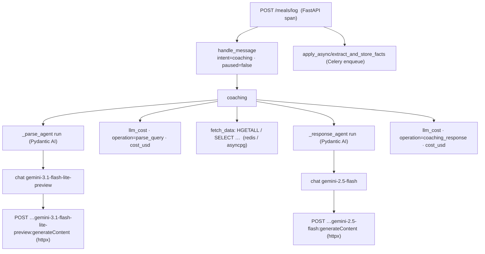
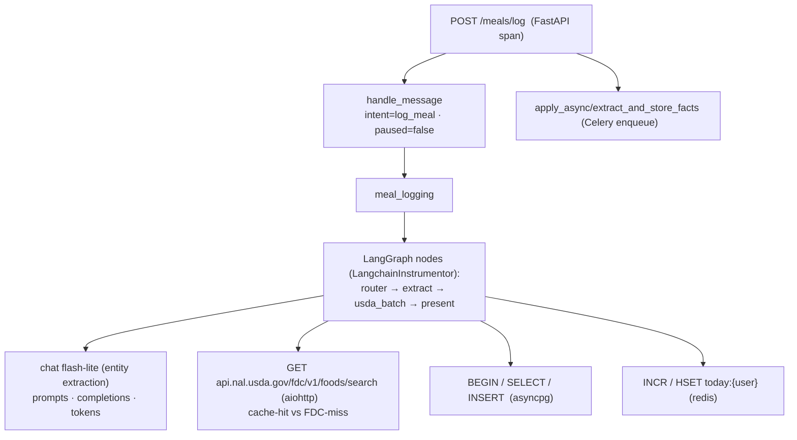
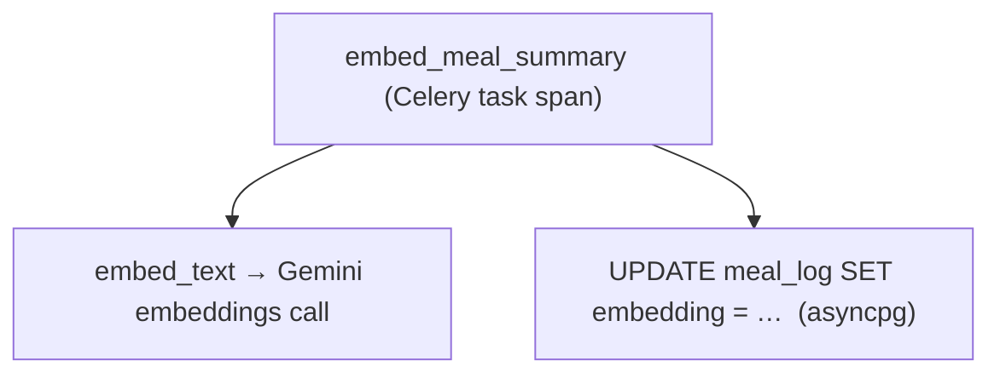

# NutriChat — Observability Workflow

> Status: reflects the implemented backend as of 2026-06-12.
> Tracing backend: **Logfire** (Pydantic's OpenTelemetry platform), EU region.
> Project: `https://logfire-eu.pydantic.dev/aswinbio/starter-project`.
> Diagrams are Mermaid (rendered by GitHub / VS Code / https://mermaid.live).

This document explains how NutriChat is instrumented, exactly what each user
action produces in the trace tree, how LLM **cost** is tracked, and how
privacy/secret scrubbing works. For the higher-level system architecture see
[`architecture.md`](./architecture.md); this file is the deep dive on §7.

---

## 1. Why Logfire

Logfire is an **OpenTelemetry (OTel) backend**. That choice matters: instead of
a tool that only sees LLM chains (the previous LangSmith setup), every layer of
the stack emits into one correlated trace tree:

- the HTTP request,
- the orchestrator's routing decision,
- the LangGraph meal-logging nodes **and** the Pydantic AI coaching agent,
- every Gemini call (prompts, completions, token usage),
- the USDA HTTP calls, Postgres queries, Redis ops, and Celery tasks.

One user message → one trace tree. You can open a slow request and see, top to
bottom, where the time and the money went.

---

## 2. Configuration

All setup lives in **`src/backend/observability.py`**, exposed as a single
idempotent function:

```python
configure_observability(app: FastAPI | None = None) -> None
```

It is called from two process types:

| Process | Call site | `app` passed? |
|---|---|---|
| FastAPI API server | `src/backend/main.py:30` — `configure_observability(app)` | yes (enables FastAPI request spans) |
| Celery worker | `src/backend/workers/tasks.py` — `@worker_process_init.connect` handler | no (workers have no FastAPI app) |

A module-level `_configured` flag makes a second call a no-op, so importing the
app and the worker in the same process (e.g. tests) never double-instruments.

### `logfire.configure(...)` parameters

```python
logfire.configure(
    service_name="nutrichat",
    environment=os.environ.get("LOGFIRE_ENVIRONMENT", "dev"),
    send_to_logfire="if-token-present",
    scrubbing=logfire.ScrubbingOptions(callback=_scrub_extra),
)
```

- **`send_to_logfire="if-token-present"`** — the keystone for safety. Without
  `LOGFIRE_TOKEN`, configuration becomes a **local no-op**: spans are created in
  memory but never exported. This is what makes tests, CI, and a fresh clone
  work with zero credentials.
- **`environment`** — tags every span with `dev` / `staging` / `prod` so you can
  filter. Set via `LOGFIRE_ENVIRONMENT`.
- **`scrubbing`** — see [§6](#6-privacy--scrubbing).

### Environment variables

| Variable | Purpose |
|---|---|
| `LOGFIRE_TOKEN` | **Write token** — authorizes span ingestion. Lives in `.env`, never committed. |
| `LOGFIRE_ENVIRONMENT` | Span environment tag (`dev` default). |

> **Token gotcha (learned the hard way).** Logfire has two credential types that
> look identical (`pylf_...`):
> - a **write token** (Project Settings → *Write tokens*) — for *sending* traces.
>   This is what `LOGFIRE_TOKEN` / `logfire.configure(token=...)` needs.
> - an **API key** (`LOGFIRE_API_KEY`) — for the *Query/Management API* (reading
>   data out, used by the Logfire MCP).
>
> Using an API key as the write token returns `401 Invalid token`. The data
> **region** (`logfire-eu` vs `logfire-us`) is auto-detected from the `_eu_` /
> `_us_` segment inside the token — no base-URL config needed.

### Tests / CI behaviour

`pyproject.toml` sets `[tool.logfire] ignore_no_config = true` so cost/span
helpers that call `logfire.info()` don't emit a "not configured" warning when
running without a token.

---

## 3. What is instrumented (full inventory)

Every instrumentor below is wrapped in `try/except ImportError` with a
`logger.warning`, so a missing optional dependency degrades gracefully instead
of crashing startup.

| Instrumentation | Call | What it captures |
|---|---|---|
| **FastAPI** | `logfire.instrument_fastapi(app)` | Route, method, status code, latency; the root span of each request tree. |
| **Pydantic AI** | `logfire.instrument_pydantic_ai()` | `agent run` + `chat <model>` spans for the coaching agent: structured output, retries, **token usage**, model name. Applies globally to all agents (see §5). |
| **LangChain / LangGraph** | `LangchainInstrumentor().instrument()` (OpenLLMetry) | Every LangGraph node run and Gemini call on the **meal-logging** path: prompts, completions, model, token usage. |
| **httpx** | `logfire.instrument_httpx(capture_all=True)` | Raw HTTP to Gemini for the **Pydantic AI** agent (GoogleModel uses httpx). Request/response bodies + headers (secrets scrubbed). |
| **aiohttp** | `logfire.instrument_aiohttp_client()` | USDA FoodData Central HTTP calls (URL, status, latency → cache-hit vs FDC-miss is visible). |
| **asyncpg** | `logfire.instrument_asyncpg()` | Every Postgres statement + latency (meal inserts, history queries, pgvector ANN, checkpoint reads/writes). |
| **Redis** | `logfire.instrument_redis()` | Redis commands (`HGETALL`/`INCR`/`LPUSH` for today-totals + the Celery broker). |
| **Celery** | `logfire.instrument_celery()` | Task enqueue (`apply_async/...`) and task execution spans in the worker. |

### Orchestrator spans (hand-written)

In `src/backend/agent/orchestrator.py`, explicit `logfire.span()` blocks add the
routing-level structure the auto-instrumentors can't know about:

| Span | Attributes | Notes |
|---|---|---|
| `handle_message` | `user_id`, `thread_id`, `has_image`, `intent`, `paused` | The per-message root under the FastAPI span. `intent`/`paused` set **after** routing resolves. |
| `classify_intent_llm` | — | Only created on the LLM-fallback branch; the keyword pre-filter path is free and emits nothing. |
| `coaching` | — | Wraps the Pydantic AI coaching pipeline. |
| `meal_logging` | — | Wraps the LangGraph invoke/resume. |

> **Never traced as attributes:** `image_b64` content and the LangGraph
> `checkpointer` object are deliberately never passed to a span — both for size
> and privacy.

---

## 4. The trace tree, per user action

### 4.1 A coaching question

`"how did I eat this week?"` → routed to the Pydantic AI coaching agent:



Notes:
- If the user has **no data** for the period, `CoachingAgent.handle()`
  short-circuits with a graceful message and the **`_response_agent` never
  runs** — so you'll see only one `llm_cost` (from `parse_query`). This is
  visible directly in the trace.
- `fetch_data` hits Redis for today+macros, Postgres otherwise (the decision
  table in `architecture.md` §4); the child spans tell you which path ran.

### 4.2 A meal log

`"two eggs and toast"` → LangGraph meal-logging graph:



The graph **pauses** at `present` (confirmation card), checkpointing full state
to Postgres. The user's next message resumes it — that's a *separate* request
tree where `handle_message` shows `paused=true` and routes straight back into
`meal_logging` without re-classifying intent.

### 4.3 A background Celery task

Runs in the **worker process**, its own trace tree (linked by the enqueue span):



Cron tasks (`aggregate_daily_summary`, `build_weekly_summary`, `reset_day_keys`)
trace the same way.

---

## 5. Pydantic AI specifics

The coaching agent is the **Pydantic AI pilot** (the meal-logging core stays on
LangGraph). Two things make its tracing work:

1. **Global instrumentation.** `logfire.instrument_pydantic_ai()` with no
   argument calls `Agent.instrument_all()`, which sets a **class-level default**
   read at *run time*. The coaching agents (`_parse_agent`, `_response_agent` in
   `coaching.py`) are constructed at **import time** — *before*
   `configure_observability()` runs — and are still traced, because the default
   is resolved when `.run()` is called, not when the agent is built. (Verified
   with Logfire's `TestExporter`.)

2. **httpx, not aiohttp.** Pydantic AI's `GoogleModel` talks to Gemini over
   **httpx**, so `instrument_httpx(capture_all=True)` is what surfaces the raw
   provider call. (USDA, on the meal path, uses aiohttp — a different
   instrumentor.) `capture_all` records bodies and headers; the API key header
   (`x-goog-api-key`) is redacted by default scrubbing — confirmed before
   enabling it.

This mirrors the canonical setup from the `building-pydantic-ai-agents` skill:
`logfire.configure()` + `logfire.instrument_pydantic_ai()` +
`logfire.instrument_httpx(capture_all=True)`.

---

## 6. Cost tracking

**Module: `src/backend/agent/cost.py`.** Token usage alone is already on every
agent span; cost tracking turns tokens into **dollars** using
[`genai-prices`](https://github.com/pydantic/genai-prices) — an **offline**
price table (no network call, no extra latency).

### How it works

After each Pydantic AI run, `coaching.py` calls:

```python
record_run_cost(result, FLASH_LITE_MODEL, operation="parse_query")
record_run_cost(result, COACHING_MODEL, operation="coaching_response")
```

`record_run_cost` (in `cost.py`):

1. reads `result.usage` (input/output tokens),
2. prices it with `calc_price(usage, model_ref=..., provider_id="google")`,
3. emits **two** signals:

| Signal | Name | Use |
|---|---|---|
| **Log-point** (nested in the trace) | `llm_cost` | Per-call drill-down: `operation`, `model`, `priced_as`, `input_tokens`, `output_tokens`, `input_usd`, `output_usd`, `cost_usd`. Appears inline next to the agent run. |
| **Metric counter** | `gen_ai.cost_usd` (unit USD) | Aggregate dashboards — sum spend over time, grouped by `model` / `operation`. |

### Model mapping

The price table matches our configured model names:

| Configured model | Priced as | Notes |
|---|---|---|
| `gemini-3.1-flash-lite-preview` | `gemini-3.1-flash-lite` | parse_query / intent |
| `gemini-2.5-flash` | `gemini-2.5-flash` | coaching response |
| `models/gemini-embedding-001` | *(not in table)* | `LookupError` → cost silently skipped; tokens still captured. |

Unknown models never raise — cost tracking must never break a user request.

### Scope

Cost tracking is wired on the **Pydantic AI** path (the coaching pilot), per the
"cost tracking with pydantic" requirement. Meal-logging (LangChain) Gemini calls
still report **token usage** via the OpenLLMetry instrumentor; extending dollar
costing to that path is a follow-up if desired.

### Building a spend dashboard

In Logfire, chart the `gen_ai.cost_usd` metric grouped by `operation` or
`model`, or query the `llm_cost` records:

```sql
-- total spend today, by operation
SELECT attributes->>'operation' AS op, sum((attributes->>'cost_usd')::float) AS usd
FROM records WHERE message = 'llm_cost'
GROUP BY op ORDER BY usd DESC;
```

---

## 7. Privacy & scrubbing

Two layers run on every exported span:

1. **Logfire default scrubbing** — redacts values whose attribute names match
   built-in secret patterns (`authorization`, `api_key`, `x-goog-api-key`,
   `token`, `password`, `secret`, …). This is what makes `capture_all=True` on
   httpx safe: the Gemini API-key header is redacted before export. Verified
   against the actual default pattern set.

2. **Custom image scrubber** — `_scrub_extra()` in `observability.py`, passed as
   `ScrubbingOptions(callback=...)`. It replaces with `"<redacted image>"`:
   - any attribute whose key path contains `image_b64`,
   - any string value matching a `data:image/...;base64,` URI,
   - any base64-looking blob ≥ 1024 chars (catches inlined images that slip
     through as plain strings).

Together with never passing `image_b64`/`checkpointer` as attributes (§3), no
image bytes and no credentials reach Logfire cloud.

---

## 8. Operational runbook

**Start the stack with tracing on:**

```bash
set -a && source .env && set +a          # loads LOGFIRE_TOKEN
uv run uvicorn backend.main:app --port 8000 --app-dir src
uv run celery -A backend.workers.tasks worker --loglevel=info
```

On startup each process prints the project URL:
`Logfire project URL: https://logfire-eu.pydantic.dev/aswinbio/starter-project`.

**Verify ingestion** (no token needed to *create* spans; token needed to
*export*):

```bash
# Healthy: no "401 Invalid token" / "Failed to export" in the logs.
grep -iE "401|failed to export|invalid token" /tmp/uvicorn.log
```

**Run without tracing** (tests, offline dev): just leave `LOGFIRE_TOKEN` unset —
`send_to_logfire="if-token-present"` makes everything a no-op.

### Troubleshooting

| Symptom | Cause | Fix |
|---|---|---|
| `401 Invalid token` | Using an **API key** as `LOGFIRE_TOKEN`. | Use a **write token** (Settings → Write tokens). |
| Spans appear locally but not in cloud | `LOGFIRE_TOKEN` unset / no-op mode. | Set the write token and restart. |
| `LogfireNotConfiguredWarning` in tests | Helper called before configure. | Already handled via `[tool.logfire] ignore_no_config`. |
| No Gemini HTTP span for coaching | httpx instrumentor missing. | Ensure `logfire.instrument_httpx()` ran (logged on startup). |

---

## 9. File map

| File | Role |
|---|---|
| `src/backend/observability.py` | `configure_observability()`, all instrumentors, image scrubber. |
| `src/backend/agent/cost.py` | `record_run_cost()`, `genai-prices` pricing, `llm_cost` log-point + `gen_ai.cost_usd` metric. |
| `src/backend/agent/orchestrator.py` | Hand-written `handle_message` / `coaching` / `meal_logging` / `classify_intent_llm` spans. |
| `src/backend/agent/coaching.py` | Pydantic AI agents; calls `record_run_cost` after each run. |
| `src/backend/main.py` | `configure_observability(app)` for the API process. |
| `src/backend/workers/tasks.py` | `worker_process_init` → `configure_observability()` for each worker. |
| `pyproject.toml` | `[tool.logfire] ignore_no_config = true`. |
